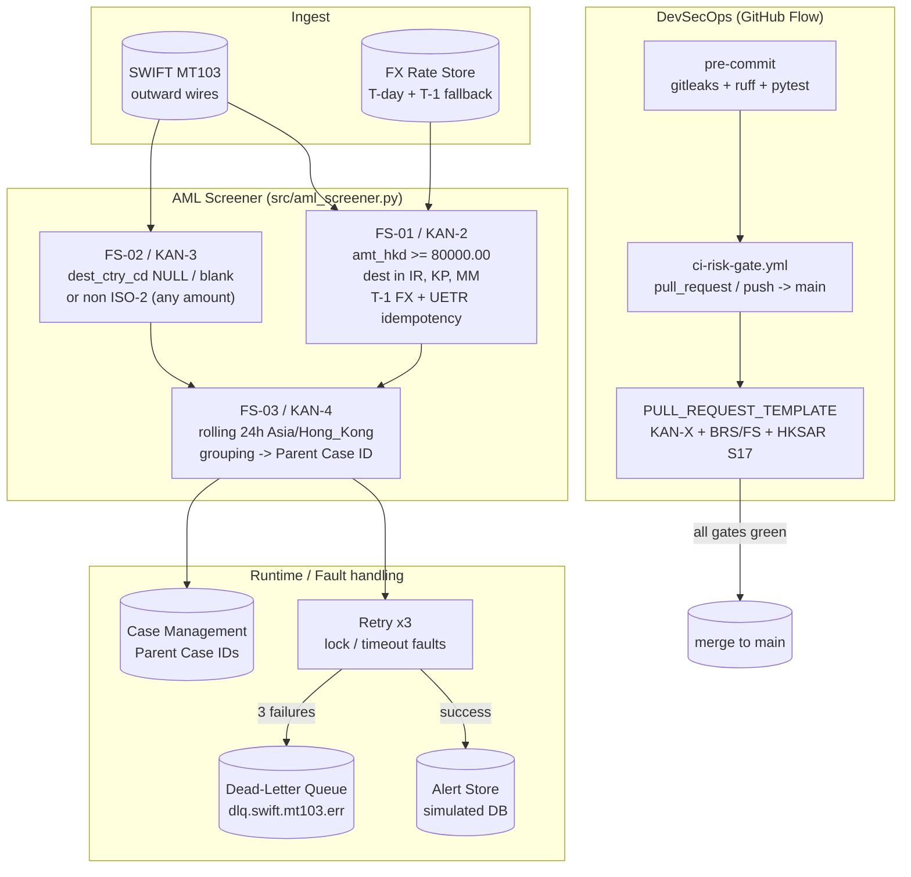
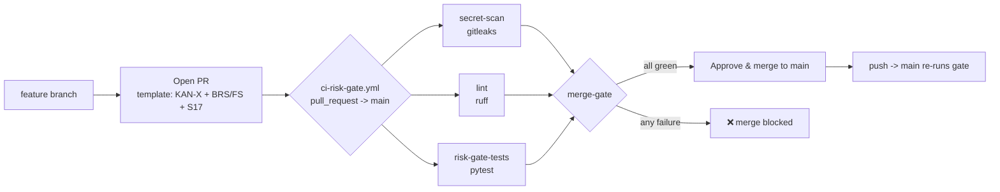

# AML & Fault Detection Engine (BRS-AML-104 / FS-AML-104)

Production-structured Python engine that screens settled **outward SWIFT MT103**
wires for anti-money-laundering typologies and handles the associated fault
detection & recovery path (retry → dead-letter queue).

Governed by **GitHub Flow** CI/CD with a blocking *risk gate* and aligned with
**HKSAR S17** security expectations.

| Artefact | Link |
| --- | --- |
| Business Requirements | [BRS-AML-104](https://confluence.example.com/display/BRS/BRS-AML-104) (Confluence) |
| Functional Specification | [FS-AML-104](https://confluence.example.com/display/FS/FS-AML-104) (Confluence) |
| Delivery board | [KAN](https://jira.example.com/browse/KAN) (Jira) — `KAN-2`, `KAN-3`, `KAN-4` |
| CI risk gate | `.github/workflows/ci-risk-gate.yml` |

> Replace the `confluence.example.com` / `jira.example.com` URLs with your
> tenant's real spaces when onboarding.

---

## 1. Architecture



### Detection rules

| Rule | Jira | Condition | Output |
| --- | --- | --- | --- |
| **FS-01** | `KAN-2` | Settled **outward MT103**, `amt_hkd >= 80000.00` (**strict**: `79999.99` never alerts), `dest_ctry_cd ∈ {IR, KP, MM}` (active list), FX via **T-1 fallback**, dedup on **`swift_uetr`** | `FS-01` alert |
| **FS-02** | `KAN-3` | Settled outward wire with `dest_ctry_cd` **NULL / blank / not a 2-letter ISO code**, **regardless of amount** | `FS-02` alert |
| **FS-03** | `KAN-4` | Repeat alerts for the same `(acct_id, bene_iban)` within a **rolling 24 h `Asia/Hong_Kong` window** share **one Parent Case ID**; DB lock/timeout faults are retried **3×**, then routed to **`dlq.swift.mt103.err`** | `PC-HKT-xxxxxx` / DLQ message |

All timestamps are normalised to **HKT (UTC+8, no DST)** so the midnight
crossover (`23:50 HKT` → `00:10 HKT`) groups into a single Parent Case.

---

## 2. Repository layout

```
aml-fault-detection/
├── src/aml_screener.py              # FS-01 / FS-02 / FS-03 engine
├── tests/test_aml_screener.py       # boundary, grouping & DLQ tests
├── .github/workflows/ci-risk-gate.yml
├── .github/PULL_REQUEST_TEMPLATE.md
├── .gitleaks.toml                   # secret scanning rules (HKSAR S17)
├── .pre-commit-config.yaml          # gitleaks + ruff + pytest
├── pyproject.toml                   # pytest / ruff configuration
└── README.md
```

---

## 3. Setup

```bash
# 1. Clone
git clone https://github.com/johnlau13168/aml-fault-detection.git
cd aml-fault-detection

# 2. Virtual environment + tooling (Python >= 3.10)
python -m venv .venv
source .venv/bin/activate          # Windows: .venv\Scripts\activate
python -m pip install --upgrade pip
python -m pip install pytest ruff pre-commit

# 3. Git hooks (secret scan + lint + tests on every commit)
pre-commit install
pre-commit run --all-files
```

### Run the tests

```bash
python -m pytest -v
```

Expected baseline:

```
43 passed in 0.0x s
```

### Lint

```bash
python -m ruff check src tests
```

### Secret scan

```bash
gitleaks detect --source . --config .gitleaks.toml --redact
```

---

## 4. CI/CD governance (GitHub Flow)



* **Triggers:** `pull_request` → `main` and `push` → `main` (+ `workflow_dispatch`).
* **Blocking checks:** `Secret Scan (Gitleaks)`, `Ruff Lint`,
  `Risk Gate Tests (pytest)`, and the aggregating `Merge Risk Gate`.
* **Branch protection (recommended):** require status checks
  `Merge Risk Gate (blocks merge on failure)` + 1 reviewer approval on `main`;
  disallow force-pushes.
* **PR template** enforces the Jira ticket (`KAN-X`), Confluence
  **BRS-AML-104 / FS-AML-104** verification and the **HKSAR S17** security
  checklist sign-off.

---

## 5. Fault handling (FS-03 / KAN-4)

| Stage | Behaviour |
| --- | --- |
| Attempt 1–3 | `TransientDBFault` (simulated lock wait / statement timeout) is retried |
| After 3 failures | Alert payload published to **`dlq.swift.mt103.err`** with `attempts`, `error` and full alert body (incl. `parent_case_id`) |
| `PermanentDBFault` | No retry — straight to DLQ |
| Screening | Never blocked by persistence failures; alerts continue to be produced |

---

## 6. Security & compliance notes (HKSAR S17 / PDPO)

* No secrets in source: enforced by **gitleaks** at pre-commit **and** CI.
* `.gitleaks.toml` adds custom rules for **SWIFT credentials**, **DB
  passwords**, **API keys**, PEM private keys and **HKID numbers** (PDPO s.33).
* Test fixtures use obviously fake identifiers only.
* Production deployments must source credentials from GitHub Environments /
  a secrets manager — never from the repository.
